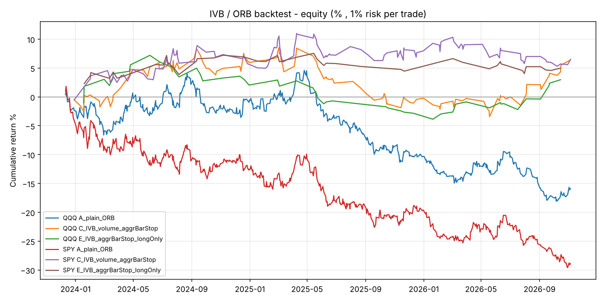

# IVB (Initial-balance Volume Breakout) — recreation & backtest

Recreation of the intraday "IVB" model Fabio Valentini describes in the World Class Edge
interview *"Inside the Mind of a World-Class Trader"*, plus a reproducible backtest.

## What Fabio actually said (the spec)

| Interview claim | How it is modelled here |
|---|---|
| "Orb supported by volume… it becomes the IVB. You don't only watch the direction, you watch the interaction of the volume using big trades or participation." | Opening-range (Initial Balance) breakout that only counts if the breakout bar shows strong participation. |
| "US indices are predictable on where the volume will arrive… you know the two hours where the maximum volatility will be there, eight sessions out of 10." | Initial Balance = first 60 min of the cash session (09:30–10:30 ET). `--ib-minutes` configurable. |
| "Take the top range and the bottom range of the battle… a passive liquidity wall on the top and on the bottom." | IB high / IB low. |
| "Once one side breaks, the probability that the day will continue in that direction is really high." | First bar that *closes* outside the IB sets the day's bias; trade in that direction, hold to the close. |
| "A lot of times it does fake breakouts… the best filter is a strong delta bar… aggressive buyers / one big participant." | OHLCV has no delta, so it is **proxied**: breakout-bar relative volume ≥ 1.2× its 20-day time-of-day average, and close location ≥ 0.7 of the bar range (≤ 0.3 for shorts). If the first break is weak, no trade that day (no re-tries). |
| "Cover yourself below this aggression and take a really asymmetrical risk to return… when it runs, it runs." | Stop just beyond the breakout ("aggression") bar; exit at the close (variant D adds a 2R target). |
| "NASDAQ is more directional than ES… still profitable on ES, but not so smooth." | Tested on QQQ (Nasdaq-100) and SPY (S&P 500). |
| GARCH regime study "boosting your win rate by 7%". | Walk-forward GARCH(1,1)-t forecast of next-day vol, refit monthly; days split by forecast above / below its 60-day median. |
| "I use the IVB as a bias system… then order flow to time." Options put/call walls, MBO big-trade prints. | **Not modelled.** No public historical data. This backtest tests the *bias layer* only. |

## Results — Yahoo 60-minute bars, Dec 2023 → Nov 2026 (730 sessions)

1% equity risked per trade, max 4× leverage, 1 bp per side for costs. Entry at the close of the
breakout bar, so there's no lookahead. If a bar touches both the stop and the target, the stop is
assumed to fill first.

| Variant | Sym | Trades | Win% | Avg R | PF | Return | Max DD | Sharpe | IS PF (2024) | OOS PF (2025–26) |
|---|---|---|---|---|---|---|---|---|---|---|
| A plain 60-min ORB, IB stop | QQQ | 581 | 49% | −0.03 | 0.88 | −15.9% | −21.7% | −0.67 | 1.00 | 0.80 |
| B IVB volume filter, IB stop | QQQ | 125 | 49% | +0.05 | 1.21 | +5.9% | −6.5% | 0.47 | 1.54 | 1.01 |
| **C IVB volume filter, aggression-bar stop** | QQQ | 125 | 46% | +0.06 | 1.15 | +6.4% | −11.0% | 0.36 | 1.32 | 1.03 |
| D = C + 2R target | QQQ | 125 | 46% | +0.04 | 1.09 | +3.8% | −11.4% | 0.24 | 1.28 | 0.96 |
| E = C long-only | QQQ | 50 | 48% | +0.06 | 1.16 | +3.0% | −10.3% | 0.26 | 1.24 | 1.10 |
| A plain 60-min ORB, IB stop | SPY | 627 | 45% | −0.05 | 0.82 | −28.9% | −30.8% | −1.13 | 0.82 | 0.82 |
| B IVB volume filter, IB stop | SPY | 124 | 48% | +0.02 | 1.08 | +2.2% | −5.8% | 0.20 | 1.74 | 0.84 |
| **C IVB volume filter, aggression-bar stop** | SPY | 124 | 48% | +0.04 | 1.12 | +6.5% | −5.1% | 0.39 | 1.31 | 1.02 |
| D = C + 2R target | SPY | 124 | 48% | +0.05 | 1.14 | +7.1% | −4.8% | 0.43 | 1.26 | 1.07 |
| E = C long-only | SPY | 48 | 50% | +0.10 | 1.33 | +5.0% | −3.3% | 0.48 | 2.23 | 0.80 |
| Buy & hold | QQQ | — | — | — | — | +68.7% | −22.8% | 0.96 | — | — |
| Buy & hold | SPY | — | — | — | — | +65.0% | −18.8% | 1.19 | — | — |

**Significance:** t-stat of mean R: QQQ C = 0.62, SPY C = 0.51; QQQ B = 0.80. Bootstrap P(mean R > 0) is 0.69–0.79.
**None of the IVB variants is statistically distinguishable from zero.** The plain ORB on SPY is
negative with a t-stat of −1.97.

**GARCH split (variant C):** SPY high-forecast-vol days PF 1.30 (win rate 53%) vs low-vol days PF 0.95.
QQQ high 1.19 vs low 1.10. The direction matches Fabio's claim, but n ≈ 60 per bucket, so this is anecdotal.

**Robustness grid** (rvol × close-location × stop mode, 48 combos): QQQ 30/48 combos have PF > 1, with a median PF of 1.04.
SPY 19/48, median PF 0.90.



### Read-out

1. **The volume / strength filter is the whole edge.** An unfiltered 60-minute ORB lost money on both indices
   over 2024–2026. Requiring an above-average-volume, strong-closing breakout bar cut trades by about 80% and
   turned the expectancy slightly positive. That's consistent with Fabio's point that fake breakouts are the
   failure mode and participation is the filter.
2. **The edge is small and not proven at this resolution.** PF is about 1.1–1.2 and drops to about 1.0
   out-of-sample, after costs. A t-stat below 1 means this could easily be noise.
3. **Regime dependence matches his description.** 2025 (tariff and headline-driven chop) was the losing year for
   QQQ, as he describes ("fake breakouts and getting back inside… when Trump tweets"). 2024 and 2026 were positive.
4. **It does not beat buy & hold** on return. Its value would come from being low-exposure and uncorrelated,
   used as a bias input rather than a standalone system, which is how he says he uses it.

## Big caveats — why this is a *lower bound* test

* **Hourly bars only.** Yahoo serves only ~730 days of 60-minute bars, and 5-minute bars for just 60 days.
  Entering at the close of a one-hour breakout bar is far later and wider than a real IVB trigger, which
  uses 1–5-minute bars and a 15–30-minute IB. The stop on the "aggression bar" is an hour wide.
* **No order flow.** Delta, big trades and MBO participant data were his real filter. Volume and
  close-location is a crude proxy.
* **No options walls, no discretionary management.**
* **About 3 years / 125 filtered trades.** He said he tested it over 10 years.

## Re-run on proper 1-minute data (2016 → today)

Alpaca SIP data goes back to 2016 with real exchange volume:

```bash
export APCA_API_KEY_ID=...        # paper or live key pair
export APCA_API_SECRET_KEY=...
python3 examples/ivb-orb-backtest/run_study.py --source alpaca --bar-minutes 5 \
  --ib-minutes 30 --output-dir reports/
```

A single variant:

```bash
python3 examples/ivb-orb-backtest/ivb_backtest.py --source alpaca --symbol QQQ \
  --bar-minutes 5 --ib-minutes 15 --rvol-min 1.5 --clv-min 0.7 \
  --stop-mode breakout_bar --output-dir reports/
```

## Files

* `ivb_backtest.py` — engine (loaders, GARCH, backtest, metrics, CLI)
* `run_study.py` — full study: variants, IS/OOS, GARCH split, grid, chart
* `results_yahoo_60m.json`, `equity_yahoo_60m.png` — snapshot of the run above
* `tests/` — `python3 -m pytest examples/ivb-orb-backtest/tests -q`

Not investment advice.
